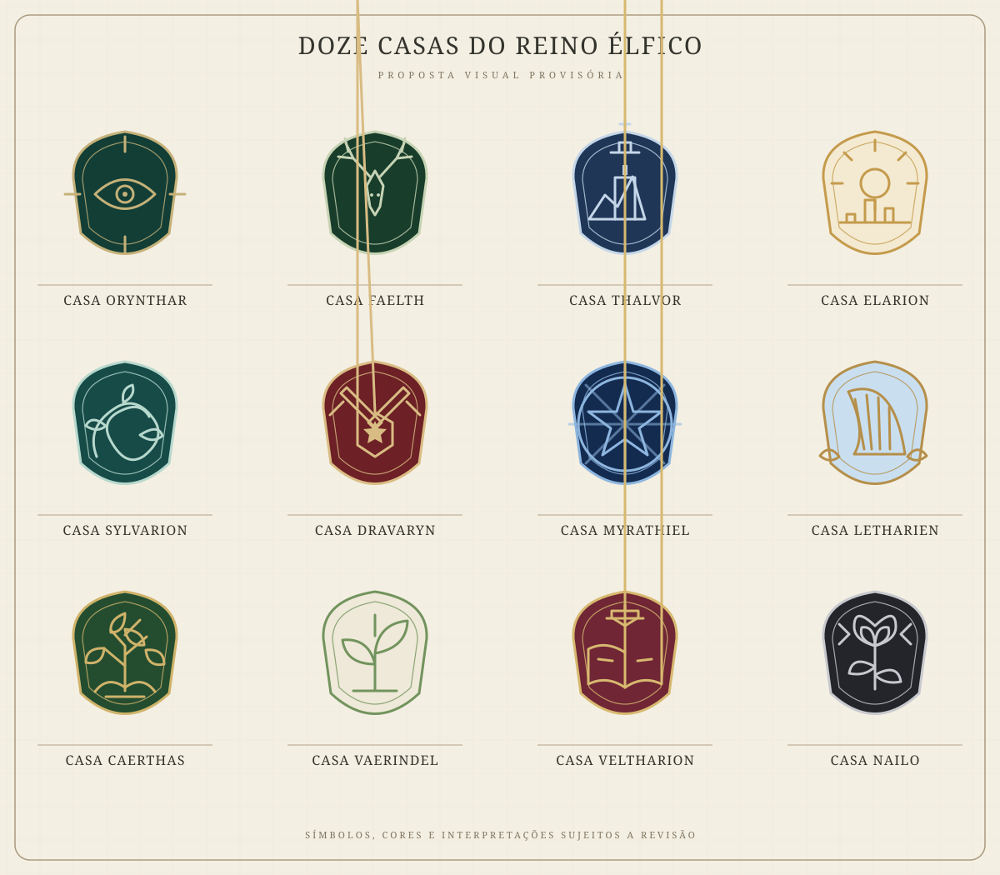

# Brasões das doze casas élficas

> **Localização:** esta documentação foi reorganizada na pasta `elfos/`. Os brasões continuam uma proposta visual sujeita a revisão individual; a aprovação da estrutura do reino não transforma os desenhos dos brasões em cânone definitivo.

> **Estado:** proposta visual provisória. O criador gostou desta primeira coleção, mas isso não torna os símbolos, cores, lemas ou interpretações cânone definitivo. Tudo permanece sujeito a revisão individual. Este arquivo registra a proposta visual atual; não altera a hierarquia política nem as funções já descritas para as casas.

## Coleção visual

**Direção artística:** heráldica élfica refinada, com escudos alongados, linhas elegantes, detalhes ornamentais e uma apresentação em pergaminho. A composição reúne os doze brasões numa única prancha.

**Nota sobre as versões visuais:** a prancha SVG em assets/brasoes-12-casas-elficas.svg é uma versão vetorial simplificada feita para ficar armazenada e visível no repositório. Ela registra a composição e os motivos principais, mas não substitui exatamente a arte rasterizada original gerada na conversa. Os rótulos e descritores na arte original podem conter pequenas imperfeições de tipografia; as descrições textuais abaixo são a referência de leitura mais clara.

## Brasões e leituras provisórias

As cores e os motivos abaixo descrevem a proposta visual atual. São escolhas visuais sugeridas, não regras definitivas de heráldica.

| Casa | Motivo visual nesta proposta | Associação pretendida |
|---|---|---|
| **Orynthar** | Olho central sobre linhas radiais, em escudo verde-escuro com detalhes dourados. | Inteligência, estratégia, segredos, observação e antecipação de conflitos. |
| **Faelth** | Cervo branco entre ramos e folhagens, sobre verde-floresta. | Floresta, costumes ancestrais e preservação dos ciclos naturais. |
| **Thalvor** | Torre sobre montanhas, sob uma estrela, em azul e prata. | Vigilância, resistência, dever, fronteiras e fortificações. |
| **Elarion** | Sol dourado sobre uma cidade de torres, em tons de ouro e marfim. | Comércio, riqueza, contratos e influência econômica. |
| **Sylvarion** | Ramos ou formas vegetais entrelaçadas, em escudo verde-azulado. | Diplomacia, alianças, equilíbrio e conexão entre interesses distintos. |
| **Dravaryn** | Escudo central com estrela, ladeado por armas cruzadas, em vermelho escuro e metal. | Comando, disciplina, estratégia e organização militar. |
| **Myrathiel** | Estrela-compasso e desenho celeste geométrico, em azul profundo e prata. | Magia, pesquisa, conhecimento arcano e investigação do desconhecido. |
| **Letharien** | Harpa, flores claras e sol, em azul-claro e dourado. | Arte, memória cultural, música, literatura e expressão ritual da fé. |
| **Caerthas** | Árvore dourada com raízes visíveis, em verde e ouro. | Território, recursos, administração e continuidade. |
| **Vaerindel** | Broto ou folhas novas num escudo claro com detalhes verdes. | Reforma, adaptação e renovação. |
| **Veltharion** | Coroa acima de um livro aberto, com ornamentos vegetais, em vinho e ouro. | Linhagem, memória ancestral, precedentes e tradição religiosa. |
| **Nailo** | Rosa branca entre ramos escuros e espinhos, em preto, prata e cinza. | Sobrevivência, vínculos incomuns, reconstrução e recuperação de influência. |

## Limites desta proposta

- Não foram definidos lemas oficiais; os termos que aparecem na imagem original são descritores temáticos, não lemas canônicos.
- Não foram estabelecidas regras formais para combinação de cores, uso em estandartes, selos, armaduras ou documentos.
- A rosa de Nailo, o olho de Orynthar, a coroa e o livro de Veltharion, assim como todos os demais motivos, podem ser alterados.
- As cores não determinam personalidade, alinhamento moral ou comportamento de cada integrante da casa.
- Para uso em jogo, pode ser necessário redesenhar brasões individuais para melhorar legibilidade em tamanhos pequenos.

## Próximos refinamentos possíveis

1. Rever cada brasão individualmente e confirmar ou substituir o símbolo principal.
2. Definir paleta oficial e regras heráldicas compartilhadas.
3. Decidir se cada casa terá lema, divisa ou apenas símbolo.
4. Produzir versões individuais para fichas, mapas, cartas, estandartes e handouts.

**Regra de continuidade:** nenhuma dessas escolhas deve ser tratada como definitiva sem aprovação expressa do criador.
